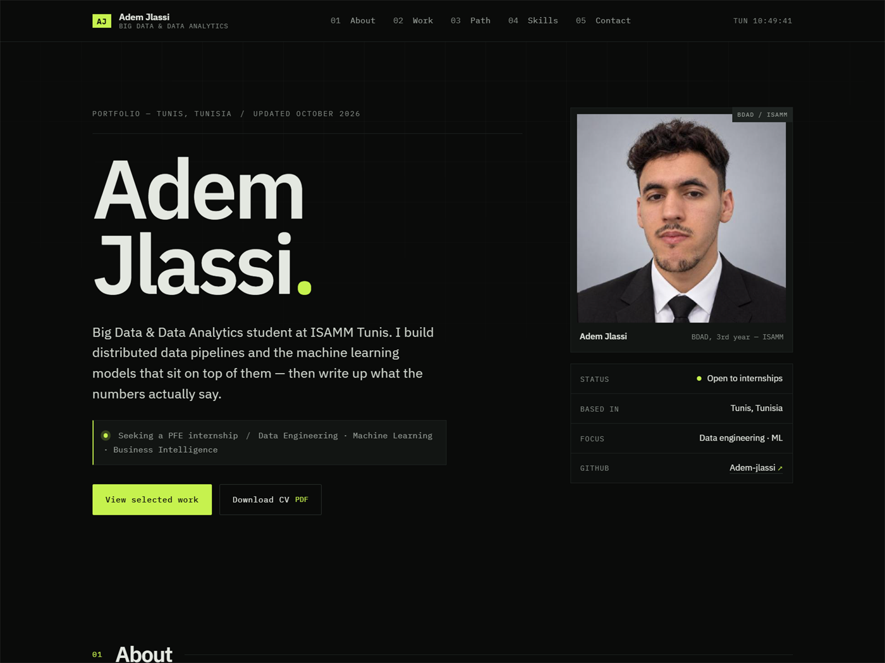

# Adem Jlassi — portfolio

[](https://adem-jlassi.github.io)
[](#run-it-locally)



Source of **[adem-jlassi.github.io](https://adem-jlassi.github.io)** — the personal
portfolio of **Adem Jlassi**, Big Data & Data Analytics student at ISAMM Tunis. Built to
sit alongside [the CV](https://adem-jlassi.github.io/Adem-Jlassi-CV.pdf) and the
[GitHub profile README](https://github.com/Adem-jlassi).

Plain HTML, CSS and ~4 KB of JavaScript. No framework, no build step, no trackers.

## What's on it

| Section | Contents |
|:--|:--|
| **Hero** | Who I am, what I'm looking for (a PFE internship), portrait, live Tunis clock |
| **About** | Short first-person note, current activity, spoken languages |
| **Selected work** | The Spark churn project featured with its metrics table, plus four more projects indexed like a contents page |
| **Path** | Internship at Tunisie Telecom, education, activities |
| **Toolkit** | Languages, big data, ML, environment — listed, not scored |
| **Contact** | Mail link, LinkedIn, GitHub, downloadable CV |

## Structure

```
.
├── index.html            # the whole page
├── styles.css            # design system, responsive rules, print styles
├── script.js             # clock, nav, scroll reveal, copy e-mail
├── assets/
│   ├── portrait.jpg      # profile photo (synced from GitHub, Oct 2026)
│   ├── preview.png       # the screenshot above
│   └── og.png            # 1200×630 card used for link previews (og:image)
├── Adem-Jlassi-CV.pdf    # downloadable CV
├── .nojekyll             # tell GitHub Pages not to run Jekyll
└── README.md             # this file
```

## Run it locally

Double-click `index.html`, or serve the folder:

```bash
npx serve .
# or
python -m http.server 8000
```

## Updating

Edit the files, then push — Pages rebuilds and the new version is live in about
30 seconds:

```bash
git add -A
git commit -m "Describe the change"
git push
```

The Pages setting lives under **Settings → Pages → Build and deployment →
Source: Deploy from a branch → `main` / root**.

## Changing the content

Everything readable is in `index.html`; the numbers, links and stack tags are
plain markup. Colours are CSS variables at the top of `styles.css` (`--acid` is
the accent, `--bg` the background). `script.js` has no dependencies.

`assets/portrait.jpg` is a local copy of the GitHub avatar, so the site never
depends on GitHub's CDN. To refresh it after changing your GitHub photo:

```powershell
Invoke-WebRequest "https://avatars.githubusercontent.com/u/189667074?s=800&v=4" -OutFile assets\portrait.jpg
```

Keep it square — the frame crops to 1:1. `assets/preview.png` is a screenshot of
the live site; re-take it whenever the design changes.

## Colophon

Typeface: IBM Plex Sans + IBM Plex Mono. Palette: near-black, hairline greys, one
acid-lime signal. Lighthouse: accessibility 100, best practices 100, SEO 100.
Designed and hand-built by Adem Jlassi, October 2026.
